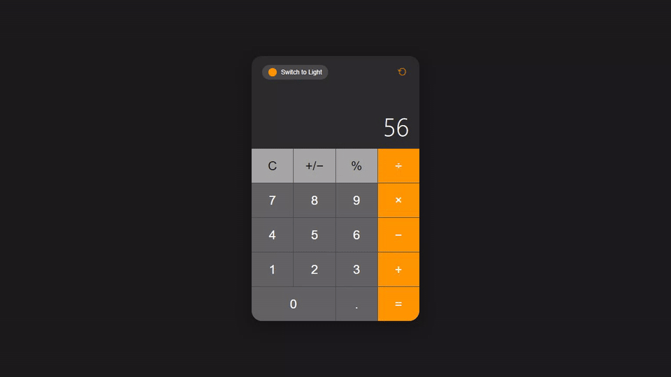
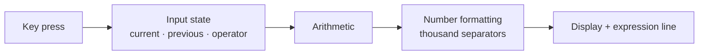
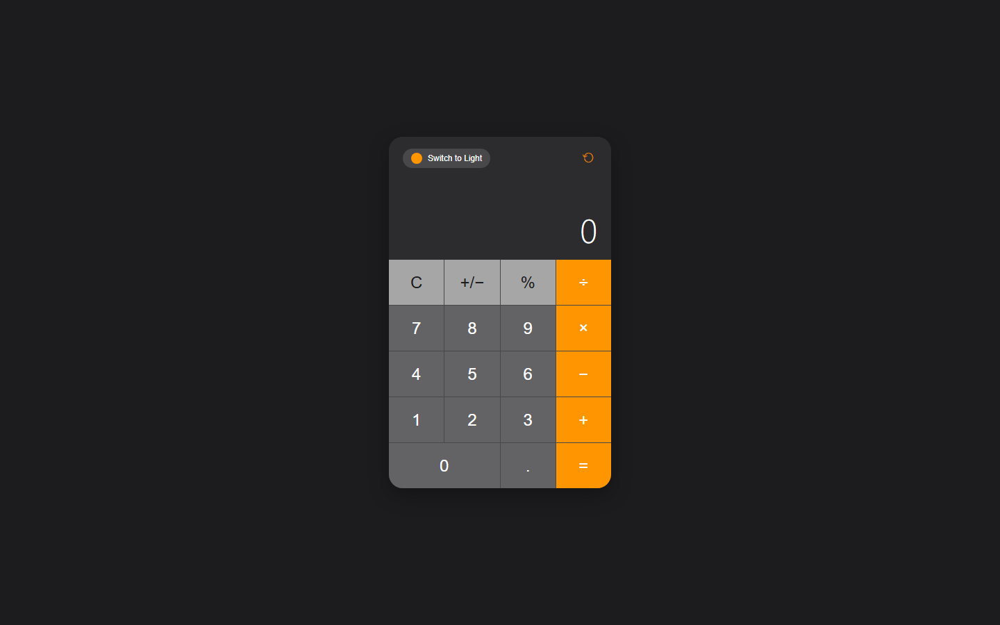
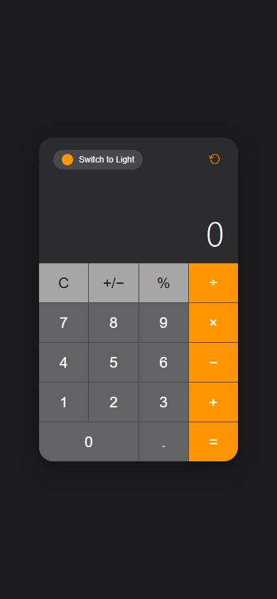

<h1 align="center">Calculator</h1>

<p align="center"><b>An iOS-inspired calculator with chained operations, keyboard support and a built-in light / dark theme switch.</b></p>

<p align="center">
[](https://mister2314.github.io/Basic-Calculator-Web-App/)


</p>

<p align="center">[**Live demo**](https://mister2314.github.io/Basic-Calculator-Web-App/) · [Quick start](#quick-start) · [Features](#features) · [Architecture](#architecture) · [FAQ](#faq)</p>

<p align="center">
  <a href="https://mister2314.github.io/Basic-Calculator-Web-App/">
    
  </a>
</p>

<p align="center"><sub>Live capture of the real build — 37 KB, loops forever.</sub></p>

## Overview

A calculator that behaves the way a calculator should: it keeps a running result, so you can chain `2 + 3 × 4` without pressing equals in between, and it shows you both the expression and the current value.

The arithmetic is deliberately not `eval`. Input is tracked as separate `currentInput`, `previousInput` and `operator` values, which makes decimal handling, sign flipping and repeated-equals behaviour explicit rather than accidental.

The whole thing is themed with CSS custom properties and ships with a dark and a light palette, switchable from the header.

## At a glance

| Field | Detail |
| --- | --- |
| **Type** | Static site — no build step |
| **Primary language** | JavaScript |
| **Live demo** | [mister2314.github.io/Basic-Calculator-Web-App](https://mister2314.github.io/Basic-Calculator-Web-App/) |
| **Repository** | [Mister2314/Basic-Calculator-Web-App](https://github.com/Mister2314/Basic-Calculator-Web-App) |

## Features

- Four operations with chained calculation — the running result feeds the next step
- Repeats the last operation when equals is pressed again
- Decimal handling, sign toggle (±) and percentage
- Live expression line above the current value
- Thousand-separator number formatting
- Full keyboard support
- Dark / light theme toggle
- No dependencies — plain HTML, CSS and JavaScript

## Tech Stack

| Layer | Technology |
| --- | --- |
| Markup | HTML5 |
| Styling | CSS3, custom-property themes |
| Logic | Vanilla JavaScript |
| Deploy | GitHub Pages |

## Architecture



## Screenshots

| Desktop | Mobile |
| :---: | :---: |
|  |  |

## Quick Start

```bash
git clone https://github.com/Mister2314/Basic-Calculator-Web-App.git
cd Basic-Calculator-Web-App

# open it directly
start index.html      # Windows
open  index.html      # macOS

# or serve the folder
npx serve .
```

## Project Structure

```
index.html — keypad, display and theme switch
script.js — input state machine, arithmetic, formatting, theme toggle
styles.css — keypad grid and both colour palettes
```

## FAQ

<details>
<summary><b>Why not just use `eval()`?</b></summary>

`eval` gets decimals and chained operations subtly wrong, and it executes whatever string it is handed. Tracking `currentInput`, `previousInput` and `operator` explicitly makes the behaviour predictable.

</details>

<details>
<summary><b>What does pressing equals twice do?</b></summary>

It repeats the last operation, which is what people expect from a physical calculator.

</details>

<details>
<summary><b>Is there keyboard support?</b></summary>

Yes — digits, operators, Enter, Backspace and Escape are all wired up.

</details>

## Roadmap

- [ ] Add a calculation history panel
- [ ] Add parentheses support
- [ ] Persist the theme and last result across reloads

## Notes

Writing the arithmetic by hand was more work than `eval` would have been, and worth it — it is the difference between a calculator that handles `0.1 + 0.2` predictably and one that does not.

## Author

**Xəyal Hüseynli** — Junior Front-End Developer

[Portfolio](https://hypnosdev.vercel.app) · [GitHub](https://github.com/Mister2314) · [LinkedIn](https://www.linkedin.com/in/x%C9%99yal-h%C3%BCseynli-3487b91ba/) · [xeyalhuseynli06@gmail.com](mailto:xeyalhuseynli06@gmail.com)
